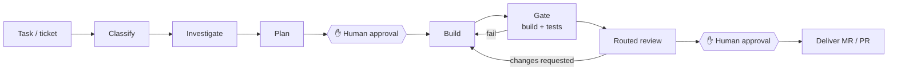

# Software Factory for Claude Code

**An engineering pipeline that makes Claude Code work on enterprise .NET systems the way a careful senior engineer would: understand first, plan, get approval, build, prove it, get reviewed, then deliver.**


Two Claude Code plugins, `dotnet-factory` for ASP.NET Core back ends and `ui-factory` for the UIs on top of them. I built it and use it daily on production government systems.

---

## Why it exists

An AI agent on a large codebase tends to fail in the same ways:

| Problem | What the factory does about it |
|---|---|
| Edits code it hasn't understood | Every repo gets a **profile** and a **knowledge graph** (Graphify). Investigation comes first, with `file:line` evidence. |
| Forces one architecture on every repo | It follows the repo's **real** patterns. Clean Architecture, CQRS or MediatR are never assumed. |
| Says "it builds" without running anything | A deterministic **gate** script runs the repo's build and tests and records the result. |
| Reviews its own work | **Independent reviewer agents**, which never saw the implementation reasoning, are chosen from the diff by a script. |
| Runs destructive commands | **Guardrail hooks** deny or ask before force-pushes, history rewrites, schema changes on remote databases and secret writes. |
| Forgets what it learned | Verified facts are saved per repo and loaded the next time. |

## The pipeline



Two human checkpoints, before code is written and before anything is pushed. Every stage writes its output to `.factory/jobs/<id>/`, so each job leaves an audit trail.

Small fixes take a **light track**: build, gate, then a single review.

## Routed, independent review

`route.mjs` reads the job's diff and decides which reviewers to start. They run in parallel as separate agents:

| Reviewer | Starts when the diff touches |
|---|---|
| `code-reviewer` | any change: correctness, business rules, scope, regressions, test honesty |
| `db-reviewer` | EF Core models, migrations, SQL, Dapper, transactions |
| `security-reviewer` | auth / JWT, roles and permissions, payments, uploads, middleware, config |
| `ui-reviewer` | views, styles, client scripts: design-system fit, RTL/LTR, accessibility, states |

Reviewers run on a smaller model by default. The larger model is used only for high-risk changes (`config/routing.json`).

## Guardrails (always on)

Hooks run on every session, whether or not a factory job is open:

- **Deny:** force-push or delete of protected branches, history rewrite, EF/SQL schema or data changes against a non-local server, recursive delete of root, home or the working folder, writing tokens or private keys, writing inside `.git/`.
- **Ask first:** `reset --hard`, `clean -f`, `branch -D`, `--no-verify`, `dotnet ef database update`, destructive SQL on a local database, MR merge or approve, literal passwords in connection strings, edits to the repo's gate or guard config.
- **Cheap context:** whole-file reads of large code files are blocked. The agent queries the knowledge graph, then reads only the line range it needs.

Protected branches by default are `main, master, develop, development, release/*, production, prod, staging`. You can add more per repo in `.factory/guard.json`.

## Live dashboard

`/dotnet-factory:dashboard` serves a read-only kanban on `http://127.0.0.1:4777/` that covers every repo registered with the factory:

**Intake → Plan → Build → Review → Needs you → Done**

Each card shows its gate result, reviewer verdicts, rounds, timing and MR link, and you can open its stage files. Approvals stay in the chat, where they are recorded.

## Install

Requires [Claude Code](https://claude.com/claude-code), Node.js 18 or later, and git. There are no npm dependencies.

```bash
claude plugin marketplace add nawafmahs/claude-dotnet-factory
claude plugin install dotnet-factory@software-factory
claude plugin install ui-factory@software-factory
```

Restart Claude Code after installing.

## Use

| Command | What it does |
|---|---|
| `/dotnet-factory:discover` | Profiles the repo (stack, real architecture, conventions, build/test commands) and sets up its gate. Run this first in a new repo. |
| `/dotnet-factory:factory <task>` | Runs the full pipeline on a task or ticket |
| `/dotnet-factory:factory status` | Lists open jobs and what's waiting on you |
| `/dotnet-factory:investigate <question>` | Root cause or impact analysis only, no edits |
| `/dotnet-factory:verify` | Runs the gate now |
| `/dotnet-factory:review` | Runs a routed independent review of the current diff |
| `/dotnet-factory:remember <fact>` | Saves a verified repo fact |
| `/dotnet-factory:dashboard` | Opens the live kanban |
| `/ui-factory:ui-discover` | Inventories the UI stack and design system |
| `/ui-factory:ui-factory <task>` | Runs the UI pipeline: UI criteria, mockup, browser check, UI review |
| `/ui-factory:ui-verify` | Checks pages in a browser at desktop and mobile widths, in RTL/LTR, with console and network |

Plain requests also start the matching stage, for example "investigate why…" or "review my changes".

## What it keeps per repo

Everything lives in `<repo>/.factory/`, which is git-excluded and never committed:

```
profile.md        repo shape, conventions, commands, delivery     (discover)
ui-profile.md     UI stack and design system as it is              (ui-discover)
checks.json       the gate: build/test commands, protected paths
guard.json        extra protected branches, allow-list             (optional)
routing.json      extra reviewer routing rules                     (optional)
knowledge/        verified repo facts + INDEX.md                   (remember)
jobs/<id>/        task, context, plan, build, checks, route, reviews, delivery
```

## Repository layout

```
.claude-plugin/marketplace.json
plugins/
  dotnet-factory/
    skills/      factory · discover · investigate · plan · build · verify · review · deliver · remember · dashboard
    agents/      investigator · code-reviewer · db-reviewer · security-reviewer
    scripts/     job · gate · route · guard · session-context · dashboard   (Node, no dependencies)
    hooks/       SessionStart + PreToolUse
    config/      routing.json
    dashboard/   index.html
    tests/       guard + scripts tests
  ui-factory/
    skills/      ui-factory · ui-discover · ui-build · ui-verify
    agents/      ui-reviewer
docs/
  architecture.md   diagrams: components, agent interaction, lifecycles
  decisions.md      every design decision, why, and what was rejected
```

## Develop

```bash
claude plugin validate .
cd plugins/dotnet-factory
node --test --test-reporter=spec tests/guard.test.mjs tests/scripts.test.mjs
```

## Design

- [Architecture and diagrams](docs/architecture.md)
- [Decision log](docs/decisions.md)

---

Built by **Nawaf Mahsoun**, Full-Stack .NET Developer · [LinkedIn](https://linkedin.com/in/nawafmahsoun) · [GitHub](https://github.com/nawafmahs)
