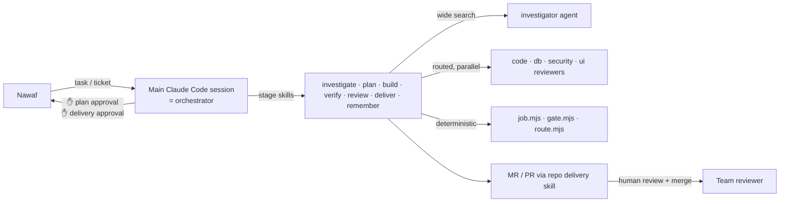
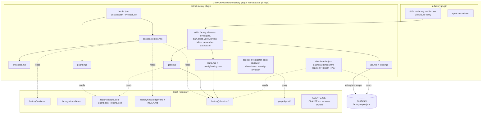
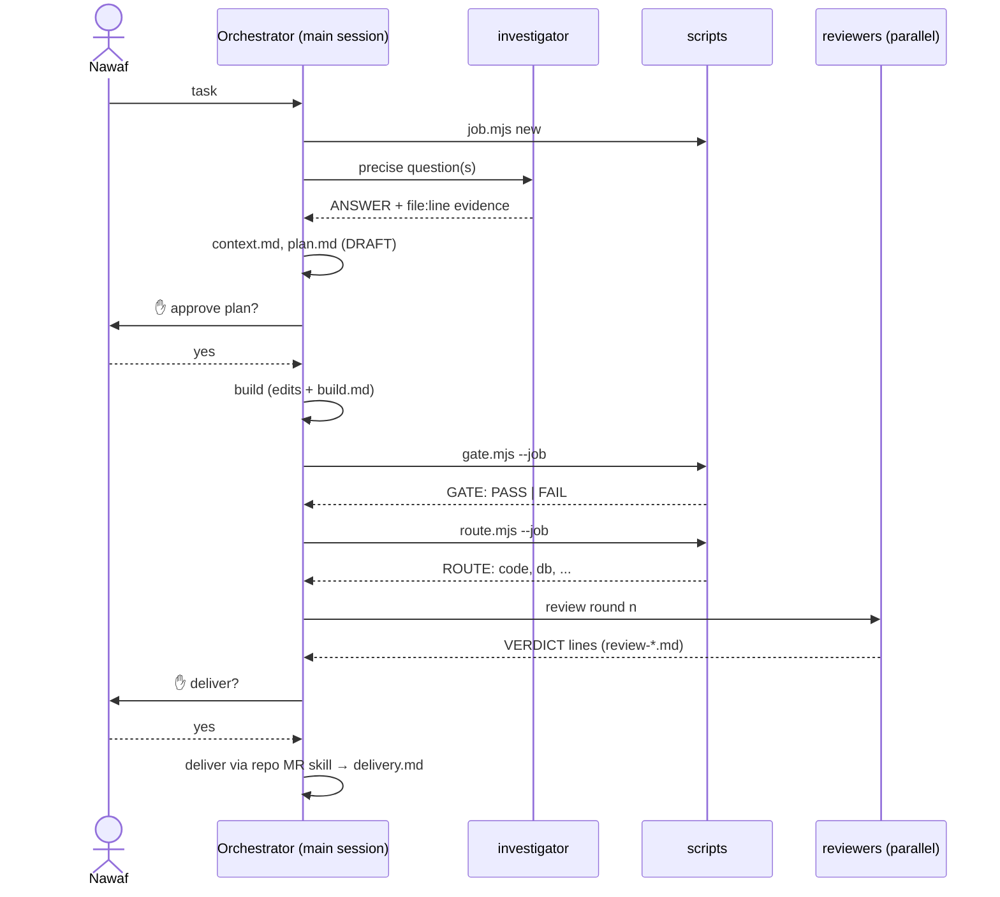
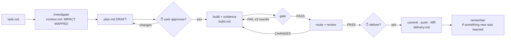
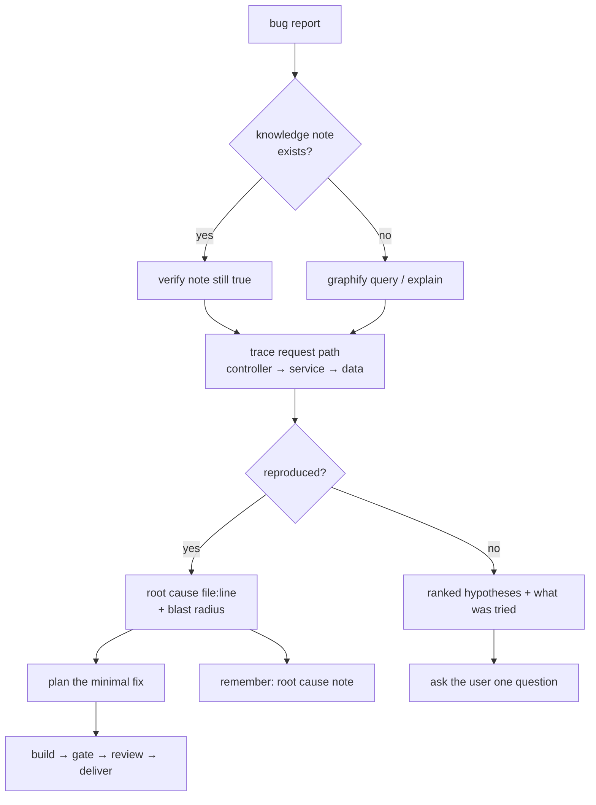
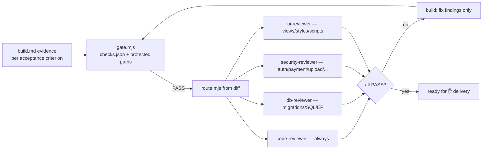
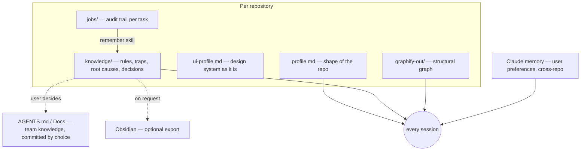
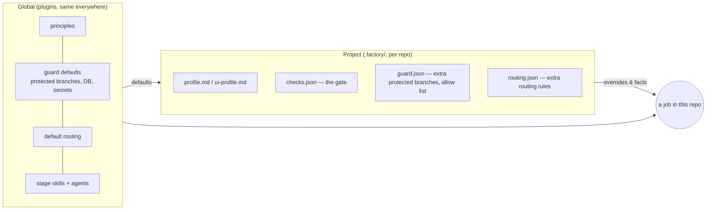
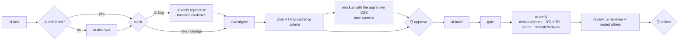

# Architecture

Diagrams are Mermaid and must stay in sync with [decisions.md](decisions.md) and the code.

## 1. Factory overview

## 2. Component architecture

## 3. Agent interaction (one job)

## 4. Feature development lifecycle

## 5. Bug investigation lifecycle

## 6. Testing and review lifecycle

## 7. Repository knowledge architecture

## 8. Global vs project configuration

## 9. UI lifecycle

